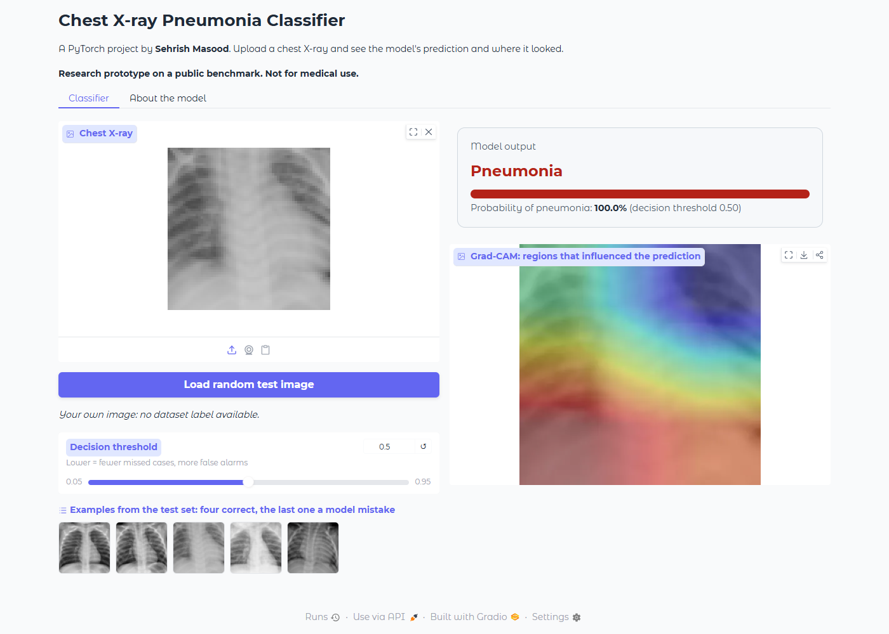

# Chest X-ray Pneumonia Classification (PyTorch)

Binary classifier (normal vs. pneumonia) on the public **PneumoniaMNIST** chest X-ray
benchmark (MedMNIST v3). A ResNet18 pretrained on ImageNet is fine-tuned, then evaluated
carefully: held-out test set, threshold analysis, calibration, error analysis and Grad-CAM.
The goal was to learn the full workflow of a vision project, including its limits, not to
chase a leaderboard score.

**Author:** Sehrish Masood

> Research/learning project on a public benchmark. **Not a medical device.**



More screenshots: [normal image](docs/demo_normal.png), [unfamiliar-image warning](docs/demo_unfamiliar_image_warning.png),
[about tab](docs/demo_about.png), [API docs](docs/api_docs.png).

## Pipeline
| Step | Script | Output |
|---|---|---|
| Train (augmentation, class-weighted loss, best epoch by validation AUC) | `src/train.py` | `outputs/best.pt`, `history.json` |
| Test-set evaluation + Grad-CAM | `src/evaluate.py` | `metrics.json`, `roc.png`, `confusion_matrix.png`, `gradcam.png` |
| Error analysis, threshold sweep, calibration | `src/error_analysis.py` | `error_summary.json`, `threshold_sweep.png`, `calibration.png`, `errors_*.png` |
| External validation on another dataset | `src/external_validation.py` | `external_validation.json`, `external_roc.png` |
| Unfamiliar-image (out-of-distribution) detector | `src/ood.py` | `ood_stats.npz`, `ood_report.json` |
| Fine-tune on external data (experiment) | `src/finetune_external.py` | `finetune_external.json` |
| Example gallery for the demo | `src/make_examples.py` | `docs/examples/` |
| Combine several runs (mean, std, bootstrap CI) | `src/aggregate.py` | `results_summary.json` |
| Shared inference code | `src/inference.py` | used by API and demo |
| REST API (FastAPI) | `src/api.py` | `/health`, `/predict`, `/predict/gradcam` |
| Interactive demo | `src/app.py` | Gradio web app |
| Tests + CI | `tests/`, `.github/workflows/ci.yml` | `pytest` on every push |
| Container | `Dockerfile` | one-command deployment |
| Documentation | `MODEL_CARD.md` | intended use, limits, ethics |

## Setup and run
```
python -m venv .venv
.venv\Scripts\activate
pip install torch torchvision --index-url https://download.pytorch.org/whl/cpu
pip install -r requirements.txt

python src/train.py --epochs 10 --size 64
python src/evaluate.py
python src/error_analysis.py
python src/app.py            # demo at http://127.0.0.1:7860
pytest -q tests
```
Optional baseline without pretraining:
```
python src/train.py --scratch --epochs 10 --size 64 --out outputs_scratch
python src/evaluate.py --out outputs_scratch
python src/aggregate.py outputs outputs_scratch
```
Training on CPU takes roughly 15 minutes (10 epochs, 64x64 images).

## Results
Setup: ResNet18 (ImageNet-pretrained), 64x64 input, 10 epochs, seed 42, single run.
Test set: 624 images (390 pneumonia, 234 normal), threshold 0.5.

| Metric | Test |
|---|---|
| AUC | 0.989 |
| Accuracy | 0.957 |
| Sensitivity (recall) | 0.982 |
| Specificity | 0.915 |
| Precision | 0.950 |
| F1 | 0.966 |

**Stability across 5 random seeds** (same setup, seeds 42, 1, 2, 3, 4; `seeds_report.md`):

| Metric | Mean | Std | Range |
|---|---|---|---|
| AUC | 0.988 | 0.002 | 0.984 – 0.989 |
| Accuracy | 0.951 | 0.008 | 0.941 – 0.958 |
| Sensitivity | 0.982 | 0.005 | 0.977 – 0.990 |
| Specificity | 0.899 | 0.018 | 0.880 – 0.915 |
| F1 | 0.962 | 0.006 | 0.954 – 0.967 |

Bootstrap 95% confidence intervals for the seed-42 run (1000 test-set resamples):
AUC 0.989 [0.982, 0.995], accuracy 0.957 [0.941, 0.971], sensitivity 0.982 [0.968, 0.995],
specificity 0.915 [0.878, 0.949]. The spread across seeds is small, so the headline result
is not a lucky run. Specificity varies most, which matters if false alarms are costly.

Confusion matrix (seed 42): 383 true positives, 214 true negatives, 20 false positives, 7 false negatives.

## Analysis
**Threshold trade-off.** At the default 0.5 threshold the model favours sensitivity over
specificity. Lowering the threshold to about 0.16 raises sensitivity to 99.2% but drops
specificity to 87.6% (`threshold_sweep.png`). In a screening setting a missed case is usually
costlier than a false alarm, so the operating point should be chosen deliberately.

**Errors.** Seven pneumonia cases were missed. Six received very low pneumonia
probabilities (0.01 to 0.35), i.e. the model was confidently wrong rather than borderline; only
one was close to the threshold (0.46). Several of the missed images look hazy, over- or
under-exposed, or contain tubes/markers, but with only seven cases I cannot draw firm
conclusions about the cause (`errors_false_negatives.png`).

**Grad-CAM.** The heatmaps are coarse, broad bands concentrated in the lower chest and
central regions rather than sharp lesion localisation. This is expected: at 64x64 input the
last ResNet stage has a tiny feature map, so the maps are low resolution. They should be
read as a rough indication of where the evidence comes from, not as proof that the model
uses medically meaningful features. For missed cases the maps are mostly empty, because the
model found no evidence of pneumonia.

**Calibration.** Predictions are saturated near 0 or 1, so the calibration plot has few
distinct bins. There is mild over-confidence in the high-probability range (one bin predicts
about 0.98 but has about 0.84 observed pneumonia). No calibration method was applied.

**External validation (different dataset, no retraining).** I ran the seed-42 model on the
ChestMNIST test set (NIH ChestX-ray14: adult patients, a different hospital), keeping images
labelled pneumonia (242) or "no finding" (11,928) (`src/external_validation.py`):

| Metric | Internal test | External (ChestMNIST) |
|---|---|---|
| AUC | 0.989 | 0.670 |
| Sensitivity at 0.5 | 0.982 | 0.649 |
| Specificity at 0.5 | 0.915 | 0.573 |

Performance drops sharply: the model flags 43% of the "no finding" and pneumonia images as
pneumonia. So the high internal numbers do not carry over to a different population. Likely
reasons (not tested separately): children vs adults, a different source and scanner, much
lower pneumonia prevalence (2% here), 64x64 resolution, and noisier labels (NIH labels were
extracted automatically from reports). The honest conclusion is that this model works on its
own benchmark and should not be expected to work elsewhere.

**Follow-up experiments on the external gap**

- *Is it a lucky seed?* No. External AUC for the five seeds: 0.670, 0.674, 0.699, 0.669, 0.677
  (mean 0.678, std 0.012). At threshold 0.5 the precision is only about 3% because pneumonia is
  about 2% of the external images, so almost every alarm would be false.
- *Fine-tuning on in-domain data* (`src/finetune_external.py`): fine-tuning for 3 epochs on 1,956
  ChestMNIST *train* images (978 pneumonia + 978 no finding) raised external test AUC from
  0.670 to 0.754. The gap closes only partly, which points to label noise, the 64x64
  resolution and the model/data limits and not only to the population change. I did not test
  which factor matters most.
- *Detecting unfamiliar images* (`src/ood.py`): a Mahalanobis-distance detector on the
  network's features, fitted on the training images. It flags 2.6% of the internal test images
  but 49.6% of a 2,000-image external sample, and separates internal from external images with
  AUC 0.935. The demo uses it to show an "unfamiliar image" warning. It is a useful signal but
  it does not make the prediction on such images correct.

## Limitations
- Low-resolution benchmark images, not clinical-quality data.
- Single official train/test split. External validation (above) shows the model does not
  generalise to a different population (AUC 0.67); multi-seed variation and bootstrap
  intervals are reported above for the internal test set only.
- Validation AUC was already about 0.99 after the first epoch and stayed flat, so the
  validation set does little to discriminate between epochs; best-epoch selection is weak.
- My test numbers are higher than the baseline figures I recall from the MedMNIST paper.
  I found no leakage in my pipeline (fixed official splits, model selected on validation only,
  threshold not tuned on test), and results are consistent across 5 seeds. But they do not
  hold up on an external dataset, so they mostly reflect this benchmark's data distribution.
- Grad-CAM is a visual aid only.

## Possible next steps
- Train on a mix of sources from the start, with stronger augmentation and higher resolution
  (128 / 224 px), and test which factor closes the external gap.
- Compare from-scratch vs. pretrained.
- Apply temperature scaling for calibration.
- Evaluate the unfamiliar-image detector on more kinds of images (photos, other modalities).

## REST API
```
uvicorn api:app --app-dir src --port 8000      # interactive docs: http://127.0.0.1:8000/docs
curl -F "file=@xray.png" "http://127.0.0.1:8000/predict?include_gradcam=true"
```
Returns the pneumonia probability, label, threshold, a disclaimer and (optionally) the
Grad-CAM overlay as base64 PNG. Files over 5 MB and non-image files are rejected.

## Docker
Train first so `outputs/best.pt` exists, then:
```
docker build -t xray-classifier .
docker run -p 8000:8000 xray-classifier
```
(Not yet tested on this machine because Docker is not installed here; CI runs the tests.)

## Demo
`python src/app.py` opens a web UI: upload an X-ray (or load a random test image) to see the
predicted probability and the Grad-CAM overlay. Add a screenshot here:
`docs/demo.png`.
